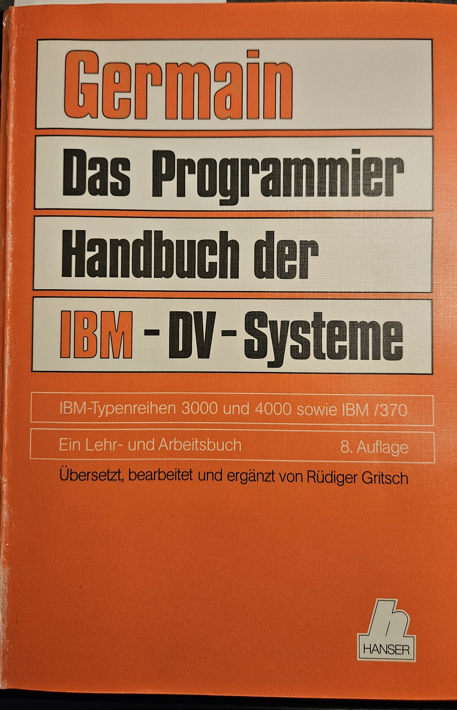

# Welcome to my IBM Mainframe Assembler Retro-Retro Education Project!
Why retro-retro? Well, first, because IBM assembler in the version of the 60ties and 70ties with 24 bit addressing is a bit retro. Second, when I started with IT as a student apprentice in the 80ties they told me that we use languages like PL/I and COBOL for regular programs. Assembler is not used any longer except for special purpose themes. Although working on several project that involved working on and programming the mainframe, I never have had the opportunity to use assembler during my career that ended 2021. So I am doing it now! The task is to study the mainframe system of the 60ties and 780ties and know enough to program The Towers of Hanoi in assembler.

Before I go into more details I want to point out that the IBM mainframe is not retro at all. The latest edition is IBM z17 with the Telum II processor that integrates an AI coprocessor. It can be used e.g. to do fraud detection using AI directly on chip within a banking transaction. It runs with up to 64 TB memory, supports up full encryption, uses post-quantum crytography. It can be run with z/OS together with or directly with LinuxONE, supports containers and Openshift Kubernetes. So you may be able to use your preferred programming language like Java, JavaScript or Python. Please refer to [IBM Z](https://www.ibm.com/products/z) for details. I enjoyed this video on z16 that can be found on [youtube](https://www.youtube.com/watch?v=ZDtaanCENbc).

Basis for my studies was mainly this book in German: Clarence B. Germain, Rüdiger Gritsch, Das Programmier-Handbuch der IBM-DV-Systeme, 8th ed, Hanser 1983. It is a translation by Gritsch with updates of Germain's book on programming the IBM 360.

  

 
 
I use the open source MVS 3.8j TK4- implementation that is available on a Herculas IBM mainframe emulation. Please find more information here: [TK4-](https://wotho.pebble-beach.ch/tk4-/)

The MVS 3.8j TK4- includes Assembler F and a bunch of compilers from the 60ties and 70ties including ALGOL, SIMULA, RPG, COBOL, PL/I and C. To run REXX I installed the BREXX/370 package V2R5M0 and Fix Level 02. The packages can be found here: [BREXX/370](https://github.com/mvslovers/brexx370/releases), the documentation here: [BREXX/370 Docu](https://brexx370.readthedocs.io/en/latest/index.html). For printing I use the HercPrt package that can be obtained from here [Software Development Laboratories](http://www.softdevlabs.com/index.html)

Before programming the Towers of Hanoi in Assembler I did it in a few other languages.

## REXX

Please notice that all statements made here are my personal opinion and all material including code of this poject are for my personal education only. There is no guarantee that any part of the project can be used in any other context reliably.
